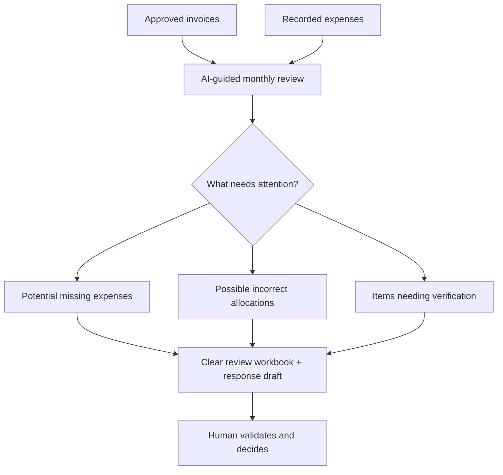
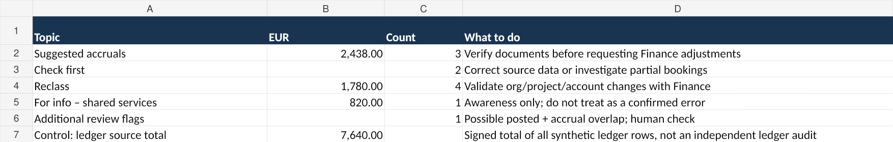

# LedgerSignal

**From manual month-end checks to a repeatable, AI-assisted finance workflow.**

*Business process design · Financial operations · AI enablement · Human-in-the-loop controls*

> **Portfolio demonstration:** All companies, suppliers, invoices, financial amounts, account codes, and sample outputs in this repository are fictional. This is an independently created public recreation of a business-led process improvement—not the original workplace Skill, files, or internal configuration. It does not post accounting entries.

## The business problem — in 30 seconds

Each month, teams need to check a simple but important question: **do the expenses Finance recorded match the invoices the business approved?**

The answer is often buried in two different spreadsheets. Finding a missing expense, a charge assigned to the wrong team, or an amount that needs clarification means manually comparing rows, references, dates, and currencies.

That work is repetitive, takes attention away from more valuable decisions, and can be hard for another colleague to pick up.

**The opportunity:** turn an individual, spreadsheet-heavy task into a consistent review process that highlights what deserves a human decision.

## Before and after

| Before: manual review | With the designed workflow |
|---|---|
| Open two files and compare entries one by one | Upload the two files and specify the month |
| Investigate mismatches without a consistent structure | Apply the same documented checks each month |
| Spend time sorting genuine issues from harmless differences | Group findings into clear actions and items to verify |
| Write up the findings from scratch | Produce a review workbook and concise Finance response |
| Rely on one person's process knowledge | Reuse a Skill, operating instructions, QA, and team onboarding |

**The objective is not to replace financial judgment. It is to give people a faster, clearer starting point for that judgment.**

## The solution

I designed a reusable **Claude Skill** that guides a monthly review using two files supplied by the reviewer:

- **Approved invoices:** what the business expected to pay or record.
- **Recorded expenses:** what appears in the Finance records.

The Skill helps compare the two, apply consistent review rules, and explain differences in plain language. It separates potentially missing items, possible misallocations, and uncertain cases instead of turning every mismatch into a proposed accounting action.



### What makes this a process solution—not just a prompt?

The workflow combines **repeatable rules**, **explicit exception handling**, **a fixed output format**, and **human review**. It is supported by short project instructions, practical QA, and a handover process so other team members can run it consistently.

It deliberately avoids automatic journal entries or unsupported claims that a discrepancy is a confirmed error.

## My contribution

I led the business and implementation side of the initiative:

1. **Diagnosed the workflow:** identified repetitive work, inconsistent checks, and decisions that needed better visibility.
2. **Defined the operating logic:** translated real review questions into rules, exception categories, and boundaries for uncertain data.
3. **Designed and iterated the Claude Skill:** specified inputs, how to handle edge cases, and what a useful answer should look like.
4. **Tested and refined the process:** reviewed outputs, challenged incorrect assumptions, and kept financial decisions subject to human validation.
5. **Enabled adoption:** created simple team-facing instructions and supported onboarding, training, QA, and knowledge transfer.

The emphasis was on turning operational knowledge into a **usable, repeatable solution**, not on writing software for its own sake.

## Business value and evidence

**Operational experience (self-reported, anonymized):** a recurring manual review that previously took approximately **2–3 hours** was reported to take approximately **20–50 minutes** with the Skill and human review. These are directional experience-based estimates, **not** a controlled time study or an independently audited productivity measure.

Other meaningful outcomes include a more consistent review structure, clearer separation of exceptions, and a process that colleagues can follow without having to reconstruct the original reviewer's approach.

**Evidence in this public repository is different:** the included fictional scenario demonstrates the approach and its controls. Its sample financial totals are **not** real-world savings, financial exposure, or production results.

## See LedgerSignal in action



The fictional demo includes straightforward cases and deliberate complications:

| What happened? | What the review highlights | What a person does next |
|---|---|---|
| An invoice was approved but has no matching record | **Potential missing expense** | Confirm the evidence before asking Finance to record it |
| An expense appears under a different account or project | **Possible misallocation** | Check whether it needs correcting |
| An amount or invoice reference is incomplete | **Check first** | Fix or clarify the source information |
| A cross-team expense may be legitimate | **Information only** | Understand it without treating it as an automatic error |

The reproducible demo has **14 automated Python tests passing**. Those tests verify the independent reference script—not Claude's consistency in an actual Skill run.

**[Open the example Excel workbook](demo/expected/month_end_review.xlsx)** · **[Explore the fictional inputs](demo/inputs/)** · **[Follow the demo guide](demo/README.md)**

## Want to look under the hood?

You can explore the business story first, or go deeper into the implementation:

| Resource | What you'll find |
|---|---|
| [Business case and ownership](docs/business-case.md) | The problem, design decisions, rollout, and value |
| [Demo walkthrough](demo/README.md) | How to try the fictional workflow |
| [Example Claude Skill](skills/month-end-expense-review/SKILL.md) | Reusable AI instructions created for this public recreation |
| [Reference Python logic](src/reconcile_demo.py) | A separate, deterministic way to reproduce demo findings |
| [Automated tests](tests/) | Checks for common edge cases and review boundaries |
| [Detailed control rules](docs/control-design.md) | Dates, matching, currencies, and exception decisions |
| [Validation and limits](docs/validation.md) | Precisely what has and has not been tested |
| [Publication safeguards](docs/publication-safety.md) | Boundaries for the synthetic portfolio release |

### Two distinct ways to explore the demo

**With Claude:** load the [fictional Skill](skills/month-end-expense-review/SKILL.md), attach the [two demo spreadsheets](demo/inputs/), and request a review for `09.2026`. The result depends on the Claude environment and has **not** been validated as deterministic.

**Without Claude:** run the independent Python reference implementation with the provided fictional CSV files:

```bash
python -m src.reconcile_demo --month 09.2026 --inputs demo/inputs --output output/demo-run
python -m unittest discover -s tests -v
```

The Python command creates text, CSV, and JSON outputs in `output/demo-run/`. The formatted Excel workbook is a **separately prepared sample** in `demo/expected/`, not generated by that Python command.

## Scope and limitations

This is a **portfolio case study and synthetic demonstrator**, not a production finance platform. There are no live ERP connections, automated postings, company financial records, or original internal materials. The Python reference is newly authored for reproducibility; it is **not** the original Skill or a substitute for Claude execution testing.

In a real finance workflow, proposed actions still require source verification, accounting-policy checks, and approval by the responsible people.

**The core lesson:** effective AI enablement starts with understanding the business process, designing the right decisions and controls, and making the result usable by others.
