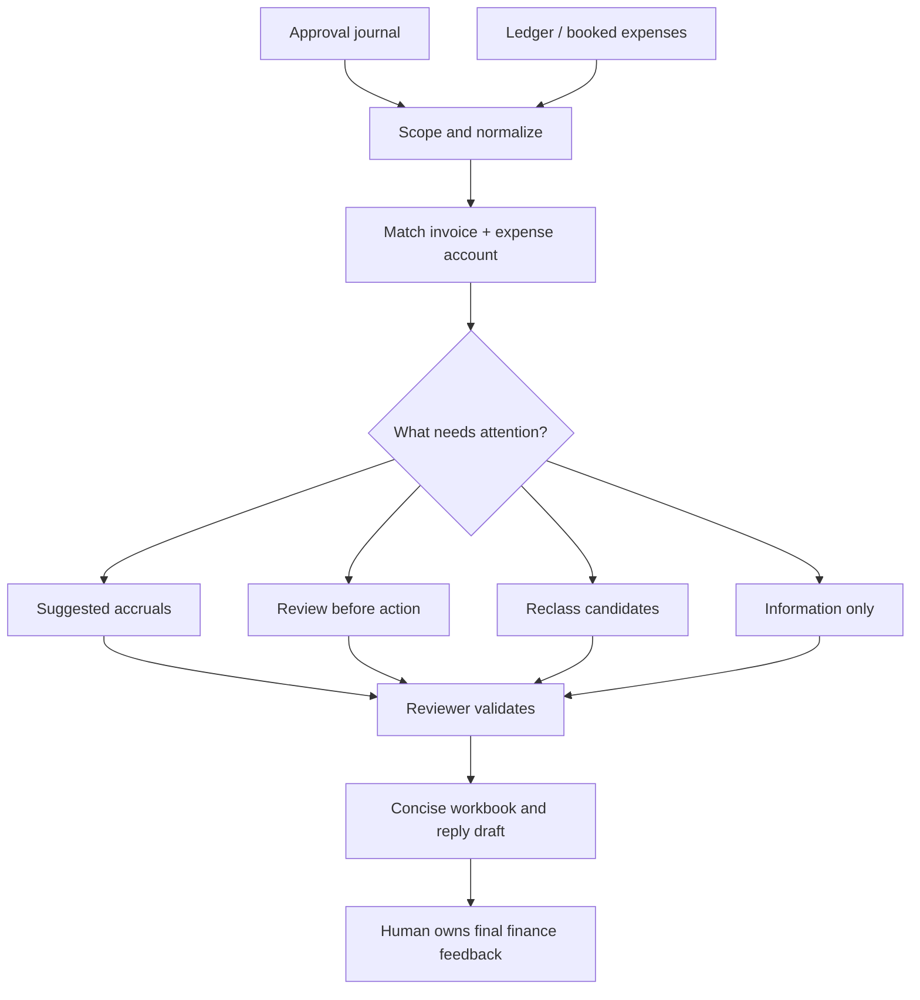

# LedgerSignal — AI-Powered Financial Reconciliation

**Intelligent month-end expense controls · Finance operations · Exception management · Human-in-the-loop review**

> **Entirely synthetic public demonstration.** Every vendor, transaction, invoice, project, account, cost-center label, document, currency amount, period-specific decision, and test result in this repository belongs to an independently authored fictional scenario. **This repository does not contain the original workplace Skill, actual company inputs, private documentation, or internal configurations.** The demonstrator is not an accounting system and performs no financial postings.

## The business problem

Many month-end review workflows depend on two separate sources: a finance team's booked expense overview and an operations team's invoice-approval journal. Although both describe overlapping activity, their formats, cutoffs, allocations and purposes differ.

Before a reviewer can give Finance actionable feedback, they must answer two deceptively simple questions:

1. **What was approved but not booked?** Flag potential accruals or missing records for review.
2. **What was booked to the wrong place?** Identify possible allocation corrections and items that should be noted only for context.

Manual spreadsheet comparison risks overlooking account splits, prior-month invoices approved after month-end, mixed currencies, reversals and errors in the approval journal itself. A simple lookup is not enough; the process needs explicit rules and review boundaries.

## The solution — a repeatable AI-assisted review

This project demonstrates how to translate operating knowledge into a reusable **Claude Skill** that can guide a structured monthly reconciliation using two **user-attached** Excel files. A small, independent Python reference implementation is included to make the demo results testable without Claude.



### Design priorities

- **Clear inputs:** two attached workbooks, a stated review period, no external data retrieval.
- **Controlled scope:** current month plus a defined prior-month approval window; late approvals and reversals handled separately.
- **Invoice-aware matching:** account splits are reviewed explicitly; normalization addresses common formatting differences.
- **Useful distinctions:** missing, check first, reclass, and information-only cases never mean the same thing.
- **Currency caution:** ledger is authoritative when available; FX estimates are clearly marked as estimates.
- **No silent accounting action:** the Skill proposes findings; a person confirms them and sends feedback.
- **Transferable operation:** a simple prompt and a fixed output template reduce dependency on one individual.

## My role

I led the business side of the solution: process diagnosis, requirements and exception logic, Skill design, iteration, quality assurance, practical rollout instructions, stakeholder coordination and user enablement. AI was the implementation medium, not a substitute for operational ownership.

This repo is a **new, generalized portfolio reconstruction**, not a publication of internal artifacts. The Python code, example datasets and outputs were created specifically for this public demonstration; they are not represented as original workplace deliverables.

## Demo results (fictional and reproducible)


The synthetic September 2026 fixture set is deliberately constructed to include a healthy match, split invoice, unbooked approvals, partial booking, missing approval amount, incorrect organization or project, wrong expense account, informational shared-services posting, potential double booking, a previous-month carryover, late approval, credit note, reversal, balance-sheet posting, and GBP-to-EUR estimate.

| Synthetic test outcome | Result |
|---|---:|
| Suggested accruals | **EUR 2,438.00** across 3 lines |
| Needs verification before action | **2 lines** |
| Reclassification candidates | **EUR 1,780.00** across 4 invoices |
| Information-only shared services | **EUR 820.00** across 1 invoice |
| Additional possible double-booking review | **1 invoice** |
| Test suite | **14 automated tests passed** |

**These numbers are deliberately invented scenario results, not business outcomes, savings estimates, financial exposure or accounting recommendations for any real organization.**

## Try it two ways

### Option A — Try the Claude Skill with example Excel files

1. Copy the Skill from [`skills/month-end-expense-review/SKILL.md`](skills/month-end-expense-review/SKILL.md) into your Claude Skill setup, or package the [`skills/`](skills/) directory with the optional [plugin manifest](.claude-plugin/plugin.json) in a compatible Claude environment.
2. Attach the two **synthetic** workbooks from [`demo/inputs/`](demo/inputs/): `approval_journal.xlsx` and `ledger_overview.xlsx`.
3. Prompt: **“Run the month-end expense controls review for 09.2026 using these two attached files. Show any uncertain findings as Check first.”**
4. Compare the output structure and key findings with the synthetic reference in [`demo/expected/`](demo/expected/).

> Claude's execution may vary with model/runtime and available file tools. The reference Python results are deterministic; the Skill itself is natural-language workflow instructions, not a standalone reconciliation engine.

### Option B — Reproduce the deterministic reference without AI

Requires Python 3.10+ and only its standard library:

```bash
python -m src.reconcile_demo --month 09.2026 --inputs demo/inputs --output demo/expected
python -m unittest discover -s tests -v
```

This generates `summary.json`, `missing.csv`, `reclass.csv`, `chat_summary.txt` and `reply_draft.txt`. A formatted synthetic workbook, `month_end_review.xlsx`, is included as a separate demonstration artifact.

## Repository guide

| Path | What it demonstrates |
|---|---|
| [`skills/month-end-expense-review/SKILL.md`](skills/month-end-expense-review/SKILL.md) | A **new** generalized Skill with workflow, decision rules and output instructions |
| [`demo/inputs/`](demo/inputs/) | Completely synthetic approval journal and booked-expense extract (CSV + Excel) |
| [`demo/expected/`](demo/expected/) | Fictional scenario findings and an Excel review workbook |
| [`src/reconcile_demo.py`](src/reconcile_demo.py) | Independently authored, testable Python reference logic |
| [`tests/`](tests/) | Automated regression tests for key business rules |
| [`docs/business-case.md`](docs/business-case.md) | Business ownership, process analysis and value proposition |
| [`docs/control-design.md`](docs/control-design.md) | Matching, timing, FX, actions, exclusions and human QA |
| [`docs/validation.md`](docs/validation.md) | Exactly what is and is not validated |
| [`docs/publication-safety.md`](docs/publication-safety.md) | Fictionalization and release-boundary checklist |

## What this demonstrates

**Business:** turning an informal recurring review into a governed, documented, transferable workflow.

**Product / solution design:** specifying input contracts, decision boundaries, exception states, simple outputs and user onboarding.

**AI enablement:** embedding domain knowledge in a reusable Skill while keeping approval and accountability with humans.

**Controls:** treating source quality, accounting cutoffs, currency and false positives as first-class requirements.

## Limitations and roadmap

- This is an educational, standalone synthetic recreation, **not a deployment of the original internal workflow**.
- The reference script uses simple exact normalized invoice identifiers, rather than sophisticated fuzzy matching or full ERP reconciliation.
- Currency conversion in the missing scenario uses a deliberately constructed observed ledger rate; it is not a booked value.
- Account classification uses fictitious categories and a small rule set; accounting professionals must validate real policies.
- No live ERP, file-sharing platform, Finance system, Claude API, scheduling or automated journal entry is connected.
- The 14 automated tests validate the Python reconstruction, **not** Claude's reasoning consistency or real-world accounting accuracy.
- Next steps in a hypothetical productized workflow: source-format adapters, field-level provenance, richer audit logs, explicit signoff, and longitudinal quality measurement.

## Publication notes

The accompanying internal source dossier is **not part of this repository**. All files in the public package should be checked again against an employer's confidentiality and intellectual-property rules before public release. See [publication safety](docs/publication-safety.md).
